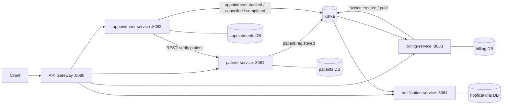

# Patient Management System: Event-Driven Microservices

Outpatient hospital workflows (registration, booking, cancellation, consultation, billing, notifications)
built as Spring Boot microservices that talk through **REST** (synchronous checks) and **Kafka** (domain events).

**Stack:** Java 21 · Spring Boot 3.3 · Spring Cloud Gateway · Apache Kafka · PostgreSQL · Docker Compose · springdoc OpenAPI · JUnit 5, Mockito, Embedded Kafka



## Documentation

| Doc | Contents |
|---|---|
| [docs/01-requirements.md](docs/01-requirements.md) | Hospital workflows mapped to service responsibilities, business rules, state machines, fee schedule |
| [docs/02-api-contracts.md](docs/02-api-contracts.md) | Every REST endpoint, request/response schemas, error format |
| [docs/03-event-contracts.md](docs/03-event-contracts.md) | Kafka topics, event payloads, sequence diagram, how cross-service consistency is kept |

Each running service also serves live OpenAPI docs at `http://localhost:<port>/swagger-ui.html`.

## Project layout

```
common/                 shared event contracts, RFC 7807 error handler, after-commit Kafka publisher, topic config
patient-service/        WF-1 registration
appointment-service/    WF-2/3/4 booking, cancellation, completion; calls patient-service over REST
billing-service/        invoices from events; pay endpoint; void/refund on cancellation
notification-service/   one message per event, deduplicated by eventId
api-gateway/            Spring Cloud Gateway routing
docs/                   requirements and contracts
scripts/demo.ps1        end-to-end walkthrough of every workflow
```

## Consistency in the event-driven design

| Problem | Solution |
|---|---|
| Event published for a transaction that rolled back | `DomainEventPublisher` sends from `@TransactionalEventListener(AFTER_COMMIT)` |
| Kafka redelivers an event | Unique keys: one invoice per `appointmentId`, one notification per `eventId` |
| `cancelled` processed before `booked` (different topics) | Billing stores a `VOID` placeholder, so the late booking is ignored |
| Patient cancels after paying | Invoice moves to `REFUND_DUE` instead of being silently voided |
| Concurrent updates to one appointment | JPA `@Version` optimistic locking |
| Producer/consumer schema drift | One set of event records in `common`, plus contract tests |
| Booking for a non-existent patient | Synchronous check against patient-service (`422`); `503` if it is down |

## Run the tests (no Docker needed)

```powershell
mvn clean install
```

There are 21 tests: unit tests for business rules, contract tests for event JSON, and Spring Boot integration tests
that use H2 and an **embedded Kafka broker** to check after-commit publishing, idempotent consumers,
out-of-order events and the HTTP error contract.

## Run the full system

Requires Docker Desktop.

```powershell
docker compose up --build -d
```

Wait about a minute for the services to start, then:

```powershell
.\scripts\demo.ps1
```

The script registers a patient, books (and tries to double-book), pays, completes, books and cancels a second visit,
then prints the patient's invoices and notifications.

## Possible next steps

* **Transactional outbox** for guaranteed delivery if Kafka is down at commit time
* Dead-letter topics for poison messages
* JWT authentication at the gateway
* Resilience4j circuit breaker on the patient-service call
* Distributed tracing (Micrometer Tracing + Zipkin)
