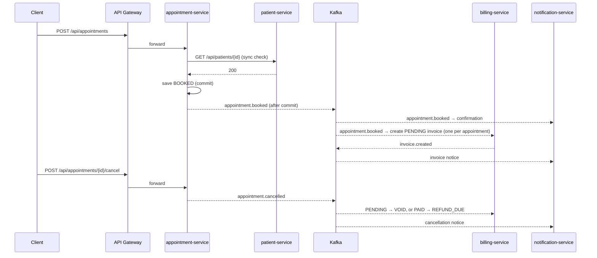

# 3. Event Contracts and Service Interactions

The Java types for every event live in the shared `common` module
(`com.hospital.common.events`), so producers and consumers compile against **one** definition.
A breaking change to an event fails the build of every service that uses it.

## 3.1 Envelope rules (all events)

| Field | Type | Purpose |
|---|---|---|
| `eventId` | UUID | Unique per event. Consumers use it to discard duplicates. |
| `occurredAt` | ISO-8601 instant | When the change was committed. |

* Serialized as JSON with no Java type headers, so any language can consume them.
* **Versioning:** fields may be added (consumers ignore unknown fields); fields are never removed or renamed. A breaking change needs a new topic (e.g. `appointment.booked.v2`).

## 3.2 Topics

| Topic | Key | Producer | Consumers |
|---|---|---|---|
| `patient.registered` | patientId | patient-service | notification |
| `appointment.booked` | appointmentId | appointment-service | billing, notification |
| `appointment.cancelled` | appointmentId | appointment-service | billing, notification |
| `appointment.completed` | appointmentId | appointment-service | notification |
| `invoice.created` | appointmentId | billing-service | notification |
| `invoice.paid` | appointmentId | billing-service | notification |

## 3.3 Payloads

```json
// patient.registered
{ "eventId": "…", "occurredAt": "…", "patientId": 1, "fullName": "Asha Menon", "email": "asha@example.com" }

// appointment.booked
{ "eventId": "…", "occurredAt": "…", "appointmentId": 7, "patientId": 1,
  "doctorName": "Dr. Rao", "department": "CARDIOLOGY", "scheduledAt": "2026-12-01T10:00:00" }

// appointment.cancelled
{ "eventId": "…", "occurredAt": "…", "appointmentId": 7, "patientId": 1, "reason": "Patient request" }

// appointment.completed
{ "eventId": "…", "occurredAt": "…", "appointmentId": 7, "patientId": 1, "department": "CARDIOLOGY" }

// invoice.created  /  invoice.paid
{ "eventId": "…", "occurredAt": "…", "invoiceId": 3, "appointmentId": 7, "patientId": 1, "amount": 1500.00 }
```

## 3.4 Interaction diagram



## 3.5 How consistency is kept across services

| Risk | Mitigation | Where |
|---|---|---|
| Event sent for a rolled-back change | Events are sent from a `@TransactionalEventListener(AFTER_COMMIT)` | `common` → `DomainEventPublisher` |
| Duplicate delivery creates two invoices | Unique constraint on `invoice.appointment_id`, plus a check before insert | billing-service |
| Duplicate delivery sends two messages | Unique constraint on `notification.event_id` | notification-service |
| Events for one appointment on one topic arrive out of order | Keyed by `appointmentId`, so they go to one partition | all producers |
| `cancelled` processed before `booked` (different topics, no ordering guarantee) | Billing stores a `VOID` placeholder; the late `booked` event finds it and does nothing | billing-service |
| Cancel arrives after payment | `PAID` → `REFUND_DUE`; paid invoices are never voided | billing-service |
| Two concurrent cancel/complete requests | `@Version` optimistic locking on appointments and invoices | appointment, billing |
| Booking for a patient who doesn't exist | Synchronous check against patient-service before saving | appointment-service |
| Producer and consumer disagree on the payload | Shared event records in `common`; contract tests deserialize real payloads | `common`, tests |

**Known trade-off:** if Kafka is unreachable right after a commit, that event is lost
(logged as an error). The production fix is a **transactional outbox** table polled by a relay,
which is listed as a next step in the README.
